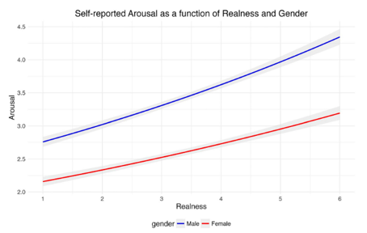
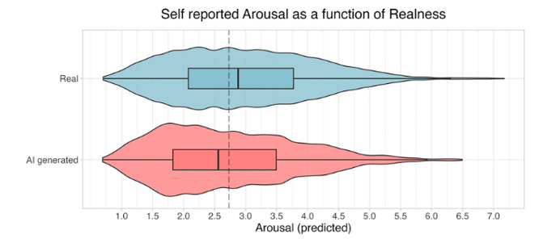
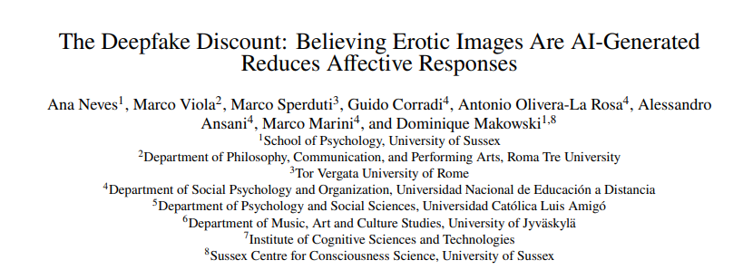
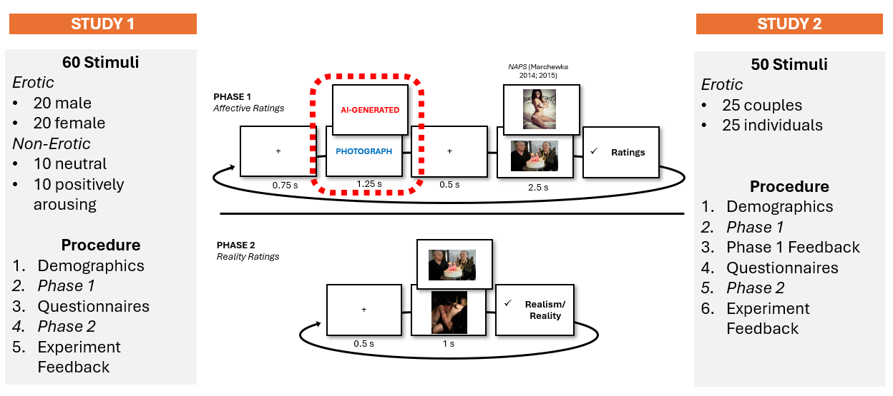
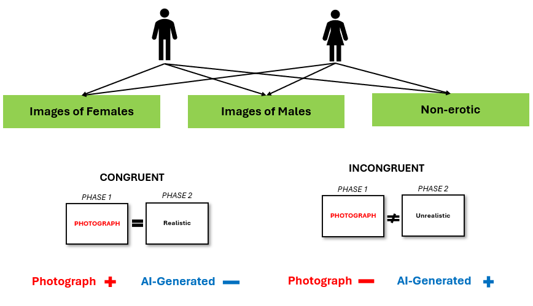
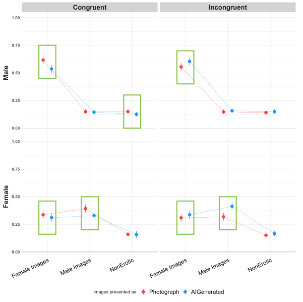
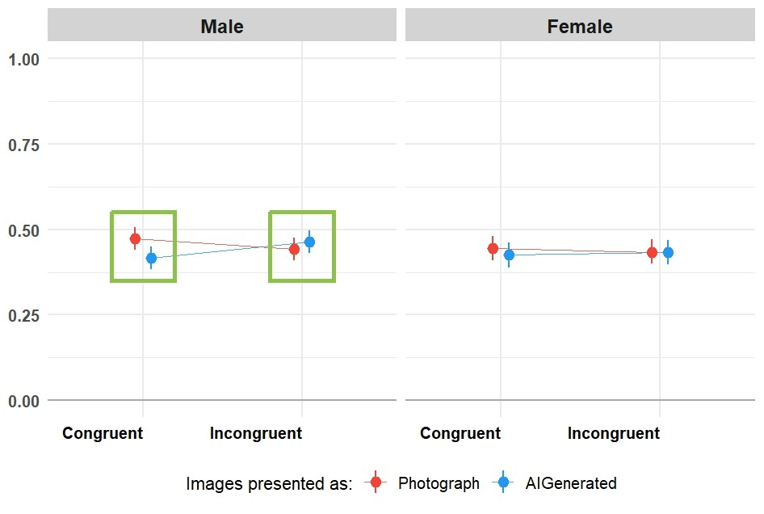
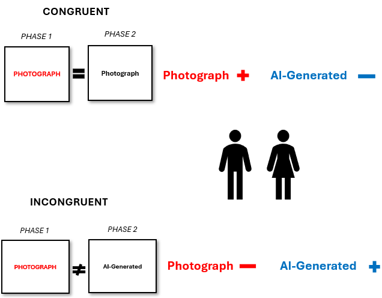
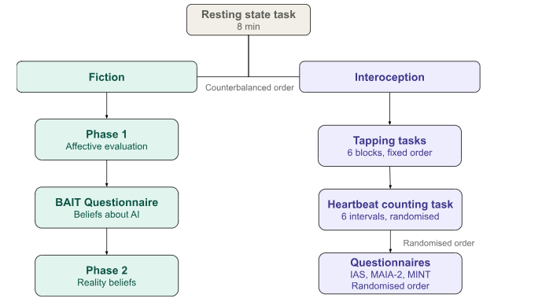
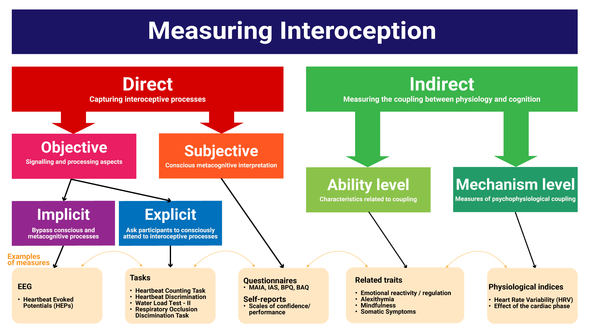

# Background {background-color="#6a596a"}

## Generative AI

- Today's AI systems are mostly [generative]{.accent}: they learn patterns from huge datasets and use them to create new content on request
- What sets them apart is [realism]{.hl}: their output is often hard to tell apart from human-made content
- That realism has consequences:
   - Misinformation and deepfakes
   - Exploitation (e.g., non-consensual sexual deepfakes) and fraud
   - Questions about creativity and authorship

::: {.fragment .keybox}
As the visual clues disappear, the question shifts from *"can people spot AI content?"* to *"how do people **decide** what is real, and what does that decision do to how they feel?"*
:::

## Two ways to study the impact of AI

:::: {.columns}

::: {.column width="50%"}
::: {.card .ai}
[**Actual** origin]{.card-title .ai}

Compare **real** AI-generated content with **real** human-made content

- People struggle to tell them apart (Nightingale & Farid, 2022; Lago et al., 2022)
- Unlabelled AI faces are even rated **more** trustworthy than real ones
:::
:::

::: {.column width="50%"}
::: {.card .photo}
[**Believed** origin]{.card-title .photo}

Show the **same** content but change what people are **told** about where it came from

- Content labelled as AI-generated is rated **less** positively: the [anti-AI bias]{.hl} (Liefooghe et al., 2023; Eiserbeck et al., 2023; Ansani et al., 2025)
:::
:::

::::

::: {.fragment .keybox}
The image is identical, only the **belief** changes, so the bias must come from **beliefs about authorship**, not from anything visible in the image.
:::

## The Reality Bending Lab

We use the [believed-origin]{.photo} approach and have tested AI labels on:

:::: {.columns}

::: {.column width="40%"}
1. Art
2. Faces
3. Negative stimuli
4. Films
5. Chats
6. [**Erotic stimuli**]{.ai}
:::

::: {.column width="60%"}
::: {.fragment .card .ai}
[Why erotic stimuli?]{.card-title .ai}

- [High arousal]{.accent} and [positive valence]{.accent}: they capture attention as much as, or more than, fear- and disgust-related images
- Strong, measurable bodily responses
- Most other anti-AI work used positive vs negative stimuli that were **not matched for arousal**
- A real target for AI misuse: most deepfake videos online are non-consensual sexual material
:::
:::

::::

## AI labels and erotic stimuli

**Marini et al. (2024)**: soft erotic images (models in underwear), Italian samples

:::: {.columns}

::: {.column width="50%"}
::: {.card .fic}
[Study 1 (N = 58)]{.card-title .fic}

The more participants **judged** an image to be real, the more arousing they found it

:::
:::

::: {.column width="50%"}
::: {.card .photo}
[Study 2 (N = 108)]{.card-title .photo}

Identical images were rated **more arousing** when **labelled** as real than as AI-generated

:::
:::

::::

## FictionEro

Our first study building on this work (*under review*)

:::: {.columns}

::: {.column width="50%"}

:::

::: {.column width="50%"}
::: {.card}
[What we changed from Marini et al.]{.card-title .accent}

- Much [larger, multi-country]{.accent} samples (4 languages)
- Validated stimuli from the [NAPS ERO]{.accent} database
- Three ratings: arousal, valence, enticement
- A second phase measuring **beliefs** about each image
:::
:::

::::

## FictionEro: Methods

## Study 1: Results {.smaller}

[`Rating ~ Gender / Relevance / Condition * Congruence + (Relevance / Condition | Participants) + (1 | Item)`]{style="font-size: 0.8em;"}

:::: {.columns}

::: {.column width="50%"}

**N = 705 heterosexual participants** (age *M* = 30.2 ± 11.8; 35.7% female) 
[**Green box**]{style="color: #04d304;"} = Probability of Direction > 97.5%
:::

::: {.column width="50%"}

:::

::::

## Study 2: Results {.smaller}

[`Rating ~ Gender / Condition * Congruence + (Condition | Participants) + (1 | Item)`]{style="font-size: 0.8em;"}

:::: {.columns}

::: {.column width="50%"}

:::

::: {.column width="50%"}

:::

::::

**N = 261 heterosexual participants** (age *M* = 37.4 ± 12.7; 48.7% female) 
[**Green box**]{style="color: #04d304;"} = Probability of Direction > 97.5%

## FictionEro: the take-home message

:::: {.columns}

::: {.column width="50%"}
::: {.card .photo}
[Congruent trials]{.card-title .photo}

The participant's later belief **agreed** with the label

→ [Photograph]{.photo} > [AI-generated]{.ai}: the expected anti-AI bias
:::
:::

::: {.column width="50%"}
::: {.card .ai}
[Incongruent trials]{.card-title .ai}

The participant's later belief **disagreed** with the label

→ the difference **reversed**
:::
:::

::::

::: {.fragment .keybox}
The label alone does not drive the effect. What matters is whether people **believe** it, and believing seems to be linked to how the image made them **feel**.
:::

# The current experiment {background-color="#6a596a"}

## Research question

::: {.keybox style="font-size: 1.1em;"}
Do [interoceptive abilities]{.int} explain **who** shows the [anti-AI bias]{.ai}, and **why**?
:::

 

:::: {.columns}

::: {.column width="50%"}
::: {.card .ai}
[Anti-AI bias]{.card-title .ai}

Rating something less positively **simply because** it is labelled as AI-generated

We treat it as a window onto how people form [reality beliefs]{.accent}
:::
:::

::: {.column width="50%"}
::: {.card .int}
[Interoception]{.card-title .int}

How well a person detects, interprets and integrates signals from **inside** their body, such as their heartbeat (Khalsa et al., 2018)
:::
:::

::::

## Two directions between belief and feeling

:::: {.columns}

::: {.column width="50%"}
::: {.card .photo}
[[Belief → Affect]{.path .ba}]{.card-title}

"I was told it's AI, so I feel less"

- Top-down: the label shapes the response
- Marini et al. Study 2
- Most anti-AI bias research looks at this direction
:::
:::

::: {.column width="50%"}
::: {.card .fic}
[[Affect → Belief]{.path .ab}]{.card-title}

"It made me feel something, so it must be real"

- Bottom-up: the response shapes the belief
- Marini et al. Study 1
- Much less studied
:::
:::

::::

::: {.fragment .keybox}
FictionEroPhysio separates these two directions **in time**: Phase 1 measures belief → affect, Phase 2 measures affect → belief.
:::

## Why would the body matter for reality beliefs?

- **Reality monitoring** (deciding what is real) depends on how **vivid** an experience feels (Johnson & Raye, 1981), and emotional experiences feel more vivid
- [Affective reality hypothesis]{.accent} (Makowski [ref]{.todo}): stronger emotional and **bodily** reactions push judgements towards "real"...
   - ...until reactions get **so intense** that regulation kicks in and pushes back towards "fake" (an inverted U shape)
   - Erotic images are one of the few stimuli arousing enough to test the descending side of this curve
- Interoception is altered when reality monitoring goes wrong:
   - **Psychosis**: higher resting heart rate, lower HRV, lower interoceptive accuracy
   - **Dissociation**: lower interoceptive accuracy and less trust in bodily signals (Woelk & Garfinkel, 2024; McDonald et al., 2026)

::: {.callout-note collapse="true"}
## What is dissociation?
"A disruption of and/or discontinuity in the normal integration of consciousness, memory, identity, emotion, perception, body representation, motor control, and behavior" (APA, 2022, p. 329)
:::

## The core idea: weighing two sources of evidence

Under **predictive processing**, a reality belief combines two sources of evidence:

:::: {.columns}

::: {.column width="50%"}
::: {.card .int}
[Bodily evidence]{.card-title .int}

"What is my body telling me?"

**Precise and accessible** (good interoception)

→ the body carries more weight

→ stronger [Affect → Belief]{.path .ab}

→ the label is more easily **overridden**
:::
:::

::: {.column width="50%"}
::: {.card .ai}
[Contextual evidence]{.card-title .ai}

"What was I told?" (the label)

**Noisy or poorly accessed** body (poor interoception)

→ the label carries more weight

→ stronger [Belief → Affect]{.path .ba}

→ a **larger** anti-AI bias
:::
:::

::::

::: {.fragment .keybox}
So interoception is not just another correlate: it may decide **which direction wins** in a given person.
:::

## Hypotheses

::: {.grid2}

::: {.card .photo .fragment}
[H1: the label effect]{.card-title .photo}
Images cued [Photograph]{.photo} get higher body reaction, valence and enticement ratings than images cued [AI-generated]{.ai}
:::

::: {.card .fic .fragment}
[H2: affect → belief]{.card-title .fic}
A stronger Phase 1 response predicts a more "Photograph" judgement in Phase 2, over and above the cue (plus a test for an **inverted U**)
:::

::: {.card .int .fragment}
[H3: interoception boosts H2]{.card-title .int}
The H2 link is **stronger** in people with **better** interoception, because bodily evidence only helps if you can read it
:::

::: {.card .ai .fragment}
[H4: interoception weakens H1]{.card-title .ai}
The label effect is **larger** in people with **poorer** interoceptive access, because they rely more on context
:::

:::

::: {.fragment .small .muted}
H3 and H4 point in opposite directions **by design**: both follow from the same weighting principle, so finding both would be much stronger evidence than either one alone.
:::

# What participants do {background-color="#6a596a"}

## Procedure

:::: {.columns}

::: {.column width="35%"}
::: {.card .rest}
[1. Set-up]{.card-title .rest}
Consent, demographics, sensors fitted
:::

::: {.card .rest}
[2. Resting state]{.card-title .rest}
8 min, eyes closed
:::

::: {.card}
[3 & 4. Two task batteries]{.card-title}
[Fiction]{.fic} and [Interoception]{.int}, order counterbalanced (odd vs even participant number)
:::

::: {.card .rest}
[5. Debrief]{.card-title .rest}
All images were real photographs
:::

[About **2 hours** in the lab]{.small .muted}
:::

::: {.column width="65%"}

:::

::::

## The tasks at a glance

:::: {.columns}

::: {.column width="50%"}
::: {.card .fic}
[Fiction]{.card-title .fic}

- **Phase 1**: affective evaluations (belief → affect)
- **BAIT** questionnaire: beliefs about AI
- **Phase 2**: reality evaluations (affect → belief)
:::
:::

::: {.column width="50%"}
::: {.card .int}
[Interoception]{.card-title .int}

- **TAP**: 6 tapping blocks
- **HCT**: Heartbeat Counting Task
- **Questionnaires**: MAIA-2, IAS, MInt
:::
:::

::::

## Fiction task: Phase 1 (affective evaluation)

**Cover story**: we are working with a young AI start-up in Brighton, and participants will see their AI-generated images mixed with real photographs

::: {.timeline}
::: {.step}
<b>Fixation</b>3 s
:::
::: {.step .cue}
<b>Cue</b>2 s [AI-generated]{.ai} / [Photograph]{.photo}
:::
::: {.step}
<b>Fixation</b>3–5 s
:::
::: {.step .img}
<b>Image</b>4 s
:::
::: {.step .rate}
<b>Ratings</b>self-paced
:::
:::

:::: {.columns}

::: {.column width="55%"}
- **Body reaction**: 0 (not at all) to 100 (strong reaction)
- **Valence**: 0 (negative) to 6 (positive)
- **Enticement**: 0 (not at all) to 6 (very much)
- **Attention check**: "What was the category of the image?"
:::

::: {.column width="45%"}
::: {.card .fic}
[The trick]{.card-title .fic}

All 50 images are **real photographs** from NAPS ERO (Wierzba et al., 2015). The label is assigned at random (half each), so any difference comes from **belief alone**.
:::
:::

::::

## Fiction task: the stimuli

:::: {.columns}

::: {.column width="50%"}
- **50 images** per participant, with a break halfway
   - **25 individuals** + **25 couples**
   - Matched to the participant's gender and sexual orientation
- Opposite-sex couples: the 25 (of 50) with the highest arousal norms across heterosexual men and women
:::

::: {.column width="50%"}
::: {.card}
[Design details worth noticing]{.card-title .accent}

- Labels are balanced **within each image category**
- The **colour** of the label is randomised per participant, so colour cannot explain the effect
- A light sensor on screen marks the **exact** moment each image appears in the physiological recording
:::
:::

::::

## Fiction task: BAIT and Phase 2

:::: {.columns}

::: {.column width="45%"}
::: {.card .accent}
[BAIT questionnaire]{.card-title .accent}

**B**eliefs about **A**rtificial **I**mage **T**echnology

- Expectations about AI content
- Attitudes towards AI
- AI knowledge and frequency of use
:::
:::

::: {.column width="55%"}
::: {.card .ai}
[Phase 2: reality beliefs]{.card-title .ai}

"The labels in the previous phase were actually **mixed up**!"

- Each image is shown again (1 s), in a new random order
- "I think this image is..." on a slider from [AI-generated]{.ai} to [Photograph]{.photo}
- Then a short feedback survey, and the debrief
:::
:::

::::

::: {.fragment .keybox}
Phase 2 gives a **trial-level** reality judgement that we can link to how the **same image** made the person feel (and how their body responded) in Phase 1.
:::

## Interoception: how it is measured

{width="80%" fig-align="center"}

::: {.fragment .small}
We cover several levels: [**objective**]{.int} (tasks, physiology) and [**subjective**]{.int} (questionnaires, confidence ratings). These often **don't correlate**, which is why we use more than one measure.
:::

## Interoception tasks {.smaller}

:::: {.columns}

::: {.column width="50%"}
::: {.card .int}
[TAP: tapping tasks (6 blocks, fixed order)]{.card-title .int}

1. **External**: tap when a rotating clock arm hits a target (40 trials)
2. **Internal**: tap whenever you choose (40 trials)
3. **Mixed**: external and internal interleaved (80 trials)
4. **Synchronisation–continuation**: tap with beeps at 42 bpm, then keep the pace from memory
5. **Random**: tap as unpredictably as possible
6. **Heartbeat**: tap along with your own heartbeat, without taking your pulse

[Why? Evidence suggests that actions are coupled with the cardiac cycle [ref]{.todo}]{.tiny}
:::
:::

::: {.column width="50%"}
::: {.card .int}
[HCT: Heartbeat Counting Task (Schandry, 1981)]{.card-title .int}

- 6 intervals (20, 25, 30, 35, 40, 45 s) in random order
- Silently count heartbeats, no pulse-taking
- Report the count, then confidence (0–5)
- **Accuracy**, **confidence** and **awareness** (how well confidence tracks accuracy)
:::

::: {.card .int}
[Questionnaires (random order)]{.card-title .int}

- **IAS**: Interoceptive Accuracy Scale (21 items)
- **MAIA-2**: 8 dimensions of interoceptive awareness (37 items)
- **MInt**: Multimodal Interoception questionnaire (33 items)
:::

HCT and questionnaires are done in random order after TAP
:::

::::

## Physiological recording

:::: {.columns}

::: {.column width="50%"}
::: {.card .accent}
[BITalino (1000 Hz)]{.card-title .accent}

- **ECG**: heart activity, throughout
- **Respiration**: chest belt, throughout
- **EDA**: skin conductance on the left hand, **Fiction Phase 1 only**
- **Light sensor**: image onset and offset
:::
:::

::: {.column width="50%"}
::: {.card .accent}
[Muse S Athena headband]{.card-title .accent}

- **EEG**: 4 dry electrodes (AF7, AF8, TP9, TP10), 256 Hz, throughout
:::

::: {.card}
[Synchronisation]{.card-title}

All streams are recorded with **Lab Streaming Layer** (LSL) into one file per task
:::
:::

::::

::: {.fragment .keybox}
This lets us compare the **actual** bodily response, the **perceived** bodily response (body reaction rating) and the **reality judgement**: the full chain behind the hypotheses.
:::

## From measures to hypotheses

| Hypothesis | Predictor | Outcome |
|:--|:--|:--|
| [**H1**]{.photo} label effect | Cue ([Photograph]{.photo} vs [AI]{.ai}) | Body reaction, valence, enticement |
| [**H2**]{.fic} affect → belief | Phase 1 ratings (and physiology) | Phase 2 reality judgement |
| [**H3**]{.int} interoception × H2 | HCT, TAP, IAS, MAIA-2, MInt | Strength of the H2 link |
| [**H4**]{.ai} interoception × H1 | HCT, TAP, IAS, MAIA-2, MInt | Size of the label effect |

## Glossary

:::: {.columns}

::: {.column width="50%"}
- **Anti-AI bias**: lower ratings for content believed to be AI-made
- **Congruence**: whether the Phase 2 belief matches the Phase 1 label
- **Interoceptive accuracy**: objective performance (e.g., HCT score)
- **Interoceptive sensibility**: self-reported ability (questionnaires)
:::

::: {.column width="50%"}
- **Interoceptive awareness**: how well confidence tracks accuracy
- **HRV**: heart rate variability
- **EDA**: electrodermal activity (sweating, a marker of arousal)
- **Reality monitoring**: deciding whether an experience is real or imagined/fake
:::

::::
